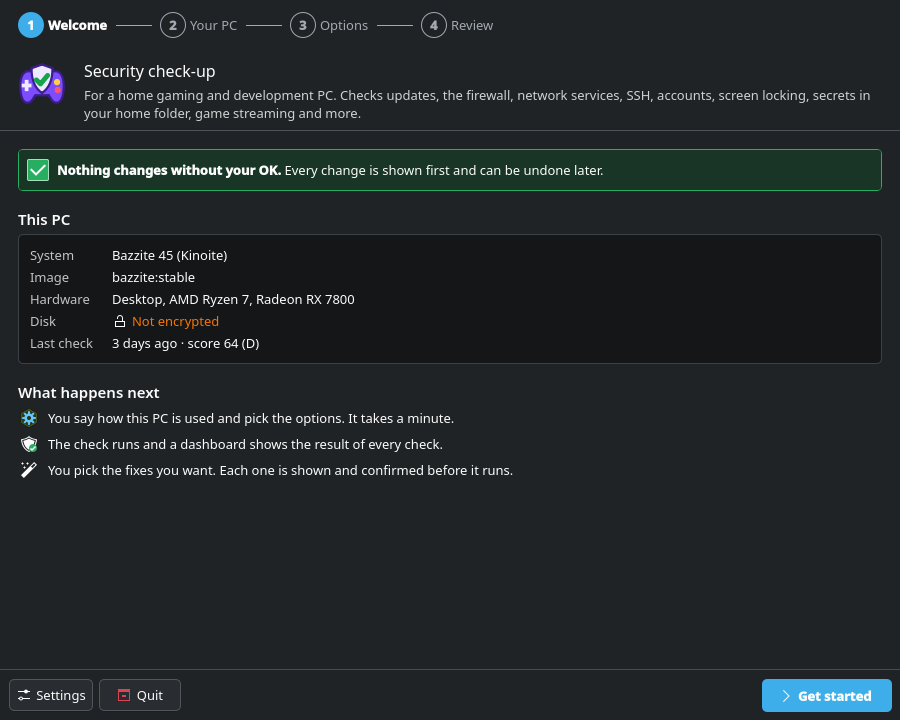
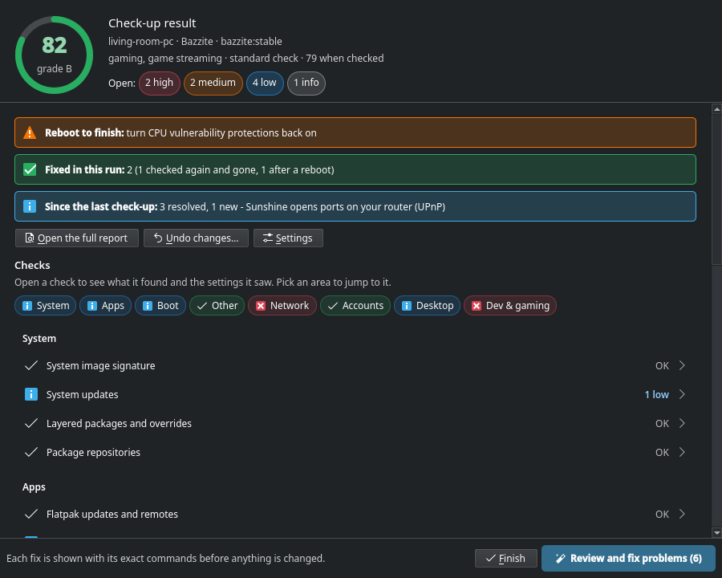
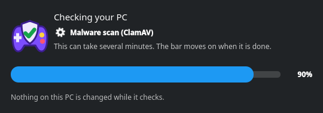

<p align="center">
  
</p>

<h1 align="center">Bazzite Security Check</h1>

<p align="center">
  <strong>A security check-up for a Bazzite home gaming and development desktop.</strong>
</p>

<p align="center">
  <a href="https://github.com/secopsxsaiyan/Bazzite_security_check/actions/workflows/ci.yml"></a>
  <a href="https://github.com/secopsxsaiyan/Bazzite_security_check/releases/latest"></a>
  <a href="https://scorecard.dev/viewer/?uri=github.com/secopsxsaiyan/Bazzite_security_check"></a>
  <a href="https://www.bestpractices.dev/projects/16708"></a>
  <a href="LICENSE"></a>
</p>

A KDE wizard asks how you use the PC. The checks then adapt to that and to what is actually installed, and a dashboard shows the result of every check. You pick fixes from a checklist; each one shows the setting now and after the fix, its side effects and its exact commands, runs only after you confirm it, is checked again afterwards, and can be undone later.

It is a desktop-friendly counterpart to [ubuntu-sec-audit](https://github.com/secopsxsaiyan/ubuntu-sec-audit), which audits servers against NIST/CIS. This tool leaves out server rules that cost more than they protect on a personal machine, and it never applies a change in bulk.

<p align="center">
  
  
</p>

## Features

- **Adapts to the PC.** Gaming, game streaming, development, SSH, file sharing and portable (laptop) use each change what is checked and how strict it is, and the wizard pre-selects what it detects.
- **Fixes you approve one by one.** Every fix shows the current setting, the result, side effects and the exact commands. Nothing changes without your OK, each fix is verified afterwards, and `--undo` reverts it.
- **Native Plasma look.** One Kirigami window for the whole run: the wizard, dashboard, fixes and settings are pages of it, questions appear over the current page, and only the scan's progress bar is a small window of its own. It follows the system theme or a forced light/dark theme; plain kdialog or the terminal when PySide6 or Kirigami is not available (installing the app offers to add them).
- **Knows what a fix touches.** Each fix names the Bazzite features it affects (Steam Remote Play, Sunshine, KDE Connect, SSH, containers, ...) and whether this PC uses them. A fix that would stop a feature you use starts unticked, and you can keep a setting on purpose so later checks stop counting it.
- **Reports you can keep.** An HTML and Markdown report per run, a score with a grade, and what changed since the last check.
- **Signed updates.** Settings → Updates installs a new release only after its SSH signature and SHA-256 checksums are verified.
- **Optional weekly check.** A report-only background run with a desktop notification.

<p align="center">
  
</p>

## Requirements

- Bazzite (KDE or GNOME) or another Fedora Atomic desktop image. On other systems it says so and asks before checking anything.
- Administrator rights (it asks through pkexec or sudo).
- Optional: PySide6 (`python3-pyside6`) and Kirigami for the Plasma window. Bazzite's KDE images have Kirigami but not PySide6; `--install` offers to add it (on Bazzite it is layered with rpm-ostree and used after the next restart). ClamAV for the `--deep` malware scan: the system's `clamav` and `clamav-freshclam` (which ClamUI also needs), or ClamTk from Flathub. When the system's ClamAV or its virus definitions are missing, the deep check offers to set them up.

## Quick start

```bash
git clone https://github.com/secopsxsaiyan/Bazzite_security_check.git ~/bazzite-sec-audit
~/bazzite-sec-audit/bazzite-sec-audit.sh
```

### Install it as an app

```bash
~/bazzite-sec-audit/bazzite-sec-audit.sh --install
```

Recommended once you have tried it. Run from the clone, the tool runs as
administrator from a folder your account can change, so a program running as
you could alter it first; the tool says so when it asks for administrator
rights. The installed app does not have that weakness.

This adds **Security Check** to the application menu (System) and the
`bazzite-sec-audit` command for every user on the PC. When you start it, KDE
asks for your administrator password, then the check-up runs as usual. The app
runs a copy owned by root in `/usr/local/libexec/bazzite-sec-audit`, so nothing
running as you can change what later runs as administrator. To update it,
install updates from Settings → Updates (or `--update`): a new release is
installed only after its signature and checksums are verified. `--uninstall`
removes the app; reports, history and undo steps are kept.

When the Plasma window cannot run because `python3-pyside6` (or Kirigami) is
missing, `--install` offers to add it, with the Qt libraries it needs (about
20 packages): with rpm-ostree on Bazzite and other Fedora Atomic images
(layered packages, used after the next restart), with dnf on Fedora. Nothing
is added without a "yes" (Enter answers "Not now"). An app
installed or updated by an older version asks once when a check-up starts
(not in a report-only run). `--uninstall` offers to remove what was added
(default: keep); if removing them fails, the app stays installed unless you
choose to remove it anyway. If a system update ever fails because of the layered
packages, remove them with `rpm-ostree uninstall python3-pyside6` (and
`kf6-kirigami`, if it was added too). The check-up's "Layered packages" fix
can remove them too, and warns that Security Check then goes back to plain
KDE dialogs.

The setup wizard, the dashboard, the fixes and Settings are pages of one
Kirigami (Plasma) window when PySide6 and Kirigami are installed (see
above); without them, or if that window fails, the same
questions come as kdialog windows or on the terminal. Settings chooses the
theme of Security Check's window (follow the system, light or dark).

For a background check once a week (report only, with a notification), add
`--install-timer`.

## What it checks

| Area | Checks |
| --- | --- |
| System | image signature, system updates, layered packages and overrides, package repositories |
| Apps | Flatpak updates and remotes, Flatpak app permissions |
| Boot | firmware updates, Secure Boot, disk encryption, kernel arguments and CPU mitigations |
| Kernel | SELinux, kernel hardening settings (sysctl) |
| Network | firewall, services reachable from the network, SSH server |
| Accounts | user accounts and passwords, sudo rules, automatic login |
| Desktop | screen locking, home folder permissions, keys and secrets in home folders |
| Dev & gaming | Docker and containers, game streaming (Sunshine), anti-cheat readiness |
| Deep (`--deep`) | SUID/SGID files, world-writable files, autostart entries, `/etc` changes compared with the image, ClamAV malware scan (and ClamAV's setup: packages, virus definitions and their automatic update) |

`bazzite-sec-audit.sh --list-checks` prints the ids for `--check` and `--skip`, and `--help` lists every option.

## What a fix can affect

Fixes that touch a Bazzite feature say so, in the fix list, the "Apply this fix?" page, each check's page and the report. For each one it says how the fix touches it (**stops it**, **changes it**, **you choose** in the fix, **helps it**, or **left as it is** when only the manual steps would change it) and whether this PC uses it, for example *"in use here: Steam is installed"*.

| Feature | Checks that can touch it | How "in use" is detected |
| --- | --- | --- |
| Steam Remote Play and LAN game transfers | firewall zone, open and unused firewall ports | you chose game streaming; Steam being installed alone is shown as "can't be told" |
| Sunshine game streaming (Moonlight) | firewall, Sunshine autostart, admin page, UPnP | Sunshine is installed, or you chose game streaming |
| KDE Connect | firewall zone, firewall ports | KDE Connect is installed |
| SSH logins to this PC | SSH server and its settings, firewall | an account has `authorized_keys`, or you chose SSH |
| File sharing (Samba, Syncthing, LocalSend) | firewall zone, firewall ports | the service is running or LocalSend is installed, or you chose file sharing |
| Finding printers and devices (mDNS) | firewall zone, port 5353 | avahi-daemon is running |
| Game servers you host | firewall ports, containers reachable from the network | cannot be told; you decide (choosing gaming does not count) |
| Docker | docker group, Docker API | the docker command or socket exists, or you chose development |
| Containers you run | containers reachable from the network | Docker is installed or Podman/Distrobox containers exist, or you chose development |
| Games with Easy Anti-Cheat | anti-cheat readiness | Steam is installed |
| Hibernation and unsigned kernel modules | anti-cheat readiness (kernel lockdown) | hibernation is set up, or DKMS/akmods build modules |
| Game performance | CPU vulnerability protections | Steam is installed, or you chose gaming |
| Controller-only play and videos | screen locking | Steam is installed, or you chose gaming |
| Developer tools and scripts | sudo without a password, SSH keys without a passphrase | development tools were detected, or you chose development |
| Flatpak apps | Flatpak app permissions | the apps listed |
| Finding this PC by name from Windows PCs | LLMNR | cannot be told; you decide |

**Kept on purpose.** On the dashboard, *Kept on purpose…* lists the problems whose fix would stop a feature you use. Tick the ones you accept: they are listed as kept, do not lower the score and are not offered as fixes, now and in later checks. A kept problem counts again if it gets more severe, and for open ports a kept problem is covered while every port it reports is one you kept - a kept port that is closed right now (Steam not running) is still covered, a new port counts again. Untick one to count it again from the next check. The choices are stored in `/var/lib/bazzite-sec-audit/kept`, which only root can change.

## Install from a release

Each [release](https://github.com/secopsxsaiyan/Bazzite_security_check/releases) has the source archive, `SHA256SUMS` and an SSH signature of the checksums. To verify one by hand, with [`release-signers`](release-signers) from this repository:

```bash
v=1.5.0
ssh-keygen -Y verify -f release-signers -I release@bazzite-sec-audit \
  -n bazzite-sec-audit-release -s SHA256SUMS.sig < SHA256SUMS
sha256sum -c SHA256SUMS
tar -xzf bazzite-sec-audit-$v.tar.gz && bazzite-sec-audit-$v/bazzite-sec-audit.sh --install
```

Installed copies update themselves the same way from Settings → Updates.

Releases after 1.4.0 also carry a build provenance attestation (`bazzite-sec-audit-$v.intoto.jsonl`), which shows the archive was built by this repository's release workflow:

```bash
gh attestation verify bazzite-sec-audit-$v.tar.gz --repo secopsxsaiyan/Bazzite_security_check
```

## Privacy and report sharing

Reports can contain hostnames, usernames, filesystem paths, service names, firewall rules, and other sensitive local details. Before you post a report or attach it to an issue, review it and redact anything you do not want to share publicly.

- Do not attach raw reports to public issues unless they are redacted.
- If you are reporting a bug, include only the smallest relevant excerpt.
- See [SECURITY.md](SECURITY.md) for private vulnerability reporting.

## Contributing and security

- Bugs and ideas: open an [issue](https://github.com/secopsxsaiyan/Bazzite_security_check/issues/new/choose). Redact reports first (see above).
- Changes: see [CONTRIBUTING.md](CONTRIBUTING.md) and the [Code of Conduct](CODE_OF_CONDUCT.md).
- Vulnerabilities: report them privately as described in [SECURITY.md](SECURITY.md), never in a public issue.
- Changes per version: [CHANGELOG.md](CHANGELOG.md).

## License

[GPL-3.0](LICENSE).
