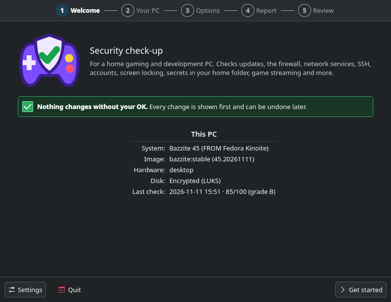
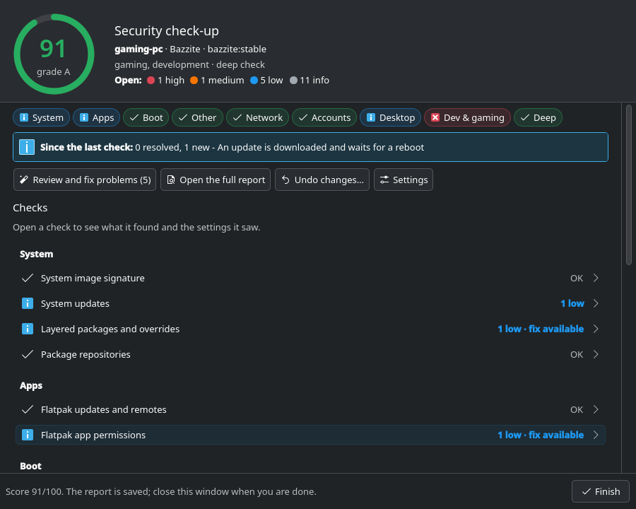
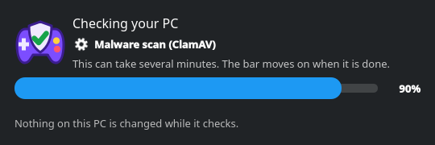

<p align="center">
  
</p>

<h1 align="center">Bazzite Security Check</h1>

<p align="center">
  <strong>A security check-up for a Bazzite home gaming and development desktop.</strong>
</p>

<p align="center">
  <a href="https://github.com/secopsxsaiyan/Bazzite_security_check/actions/workflows/ci.yml"></a>
  <a href="https://github.com/secopsxsaiyan/Bazzite_security_check/releases/latest"></a>
  <a href="LICENSE"></a>
</p>

A KDE wizard asks how you use the PC. The checks then adapt to that and to what is actually installed, and a dashboard shows the result of every check. You pick fixes from a checklist; each one shows the setting now and after the fix, its side effects and its exact commands, runs only after you confirm it, is checked again afterwards, and can be undone later.

It is a desktop-friendly counterpart to [ubuntu-sec-audit](https://github.com/secopsxsaiyan/ubuntu-sec-audit), which audits servers against NIST/CIS. This tool leaves out server rules that cost more than they protect on a personal machine, and it never applies a change in bulk.

<p align="center">
  
  
</p>

## Features

- **Adapts to the PC.** Gaming, game streaming, development, SSH, file sharing and portable (laptop) use each change what is checked and how strict it is, and the wizard pre-selects what it detects.
- **Fixes you approve one by one.** Every fix shows the current setting, the result, side effects and the exact commands. Nothing changes without your OK, each fix is verified afterwards, and `--undo` reverts it.
- **Native Plasma look.** Kirigami windows for the wizard, progress, dashboard and settings, following the system theme or a forced light/dark theme; plain kdialog or the terminal when Kirigami is not available.
- **Reports you can keep.** An HTML and Markdown report per run, a score with a grade, and what changed since the last check.
- **Signed updates.** Settings → Updates installs a new release only after its SSH signature and SHA-256 checksums are verified.
- **Optional weekly check.** A report-only background run with a desktop notification.

<p align="center">
  
</p>

## Requirements

- Bazzite (KDE or GNOME) or another Fedora Atomic desktop image. On other systems it says so and asks before checking anything.
- Administrator rights (it asks through pkexec or sudo).
- Optional: PySide6 and Kirigami for the Plasma windows (present on Bazzite KDE), ClamAV for the `--deep` malware scan.

## Quick start

```bash
git clone https://github.com/secopsxsaiyan/Bazzite_security_check.git ~/bazzite-sec-audit
~/bazzite-sec-audit/bazzite-sec-audit.sh
```

### Install it as an app

```bash
~/bazzite-sec-audit/bazzite-sec-audit.sh --install
```

This adds **Security Check** to the application menu (System) and the
`bazzite-sec-audit` command for every user on the PC. When you start it, KDE
asks for your administrator password, then the check-up runs as usual. The app
runs a copy owned by root in `/usr/local/libexec/bazzite-sec-audit`, so nothing
running as you can change what later runs as administrator. To update it,
install updates from Settings → Updates (or `--update`): a new release is
installed only after its signature and checksums are verified. `--uninstall`
removes the app; reports, history and undo steps are kept.

The setup wizard and Settings use a Kirigami (Plasma) window when PySide6 and
Kirigami are installed, as on Bazzite's KDE images; Settings chooses the theme
of Security Check's windows (follow the system, light or dark).

For a background check once a week (report only, with a notification), add
`--install-timer`.

## What it checks

| Area | Checks |
| --- | --- |
| System | image signature, system updates, layered packages and overrides, package repositories |
| Apps | Flatpak updates and remotes, Flatpak app permissions |
| Boot | firmware updates, Secure Boot, disk encryption, kernel arguments and CPU mitigations |
| Kernel | SELinux, kernel hardening settings (sysctl) |
| Network | firewall, services reachable from the network, SSH server |
| Accounts | user accounts and passwords, sudo rules, automatic login |
| Desktop | screen locking, home folder permissions, keys and secrets in home folders |
| Dev & gaming | Docker and containers, game streaming (Sunshine), anti-cheat readiness |
| Deep (`--deep`) | SUID/SGID files, world-writable files, autostart entries, `/etc` changes compared with the image, ClamAV malware scan |

`bazzite-sec-audit.sh --list-checks` prints the ids for `--check` and `--skip`, and `--help` lists every option.

## Install from a release

Each [release](https://github.com/secopsxsaiyan/Bazzite_security_check/releases) has the source archive, `SHA256SUMS` and an SSH signature of the checksums. To verify one by hand, with [`release-signers`](release-signers) from this repository:

```bash
v=1.2.0
ssh-keygen -Y verify -f release-signers -I release@bazzite-sec-audit \
  -n bazzite-sec-audit-release -s SHA256SUMS.sig < SHA256SUMS
sha256sum -c SHA256SUMS
tar -xzf bazzite-sec-audit-$v.tar.gz && bazzite-sec-audit-$v/bazzite-sec-audit.sh --install
```

Installed copies update themselves the same way from Settings → Updates.

## Privacy and report sharing

Reports can contain hostnames, usernames, filesystem paths, service names, firewall rules, and other sensitive local details. Before you post a report or attach it to an issue, review it and redact anything you do not want to share publicly.

- Do not attach raw reports to public issues unless they are redacted.
- If you are reporting a bug, include only the smallest relevant excerpt.
- See [SECURITY.md](SECURITY.md) for private vulnerability reporting.

## Contributing and security

- Bugs and ideas: open an [issue](https://github.com/secopsxsaiyan/Bazzite_security_check/issues/new/choose). Redact reports first (see above).
- Changes: see [CONTRIBUTING.md](CONTRIBUTING.md) and the [Code of Conduct](CODE_OF_CONDUCT.md).
- Vulnerabilities: report them privately as described in [SECURITY.md](SECURITY.md), never in a public issue.
- Changes per version: [CHANGELOG.md](CHANGELOG.md).

## License

[GPL-3.0](LICENSE).
